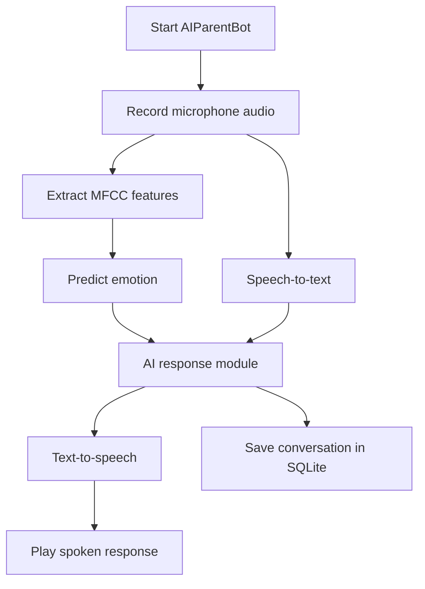

# 🤖 AIParentBot — AI-Powered Parent Assistance Chatbot

An experimental Python-based voice assistant designed to respond with empathy and emotional awareness. AIParentBot combines audio recording, speech-to-text, voice-emotion classification, an AI response module, text-to-speech, and SQLite conversation storage.

> **Project status:** This repository currently contains a local Python prototype. It is not a hosted web application, and a public live demo is not available from the current code alone.

## 🔗 Project Links

- **GitHub Repository:** [https://github.com/TheZohaibKhan/AIParentBot](https://thezohaibkhan.github.io/AIParentBot/)
- **Live Demo:** Not deployed yet. The current program uses a local microphone and Python modules, so it cannot run directly on GitHub Pages. A web interface and a suitable Python hosting deployment would be needed for a browser-based demo.

## 📑 Table of Contents

- [Overview](#-overview)
- [Features](#-features)
- [Technology Stack](#-technology-stack)
- [How It Works](#-how-it-works)
- [Project Structure](#-project-structure)
- [Prerequisites](#-prerequisites)
- [Installation](#-installation)
- [Configuration and API Keys](#-configuration-and-api-keys)
- [Run the Project](#-run-the-project)
- [Emotion Model Training](#-emotion-model-training)
- [Conversation Memory](#-conversation-memory)
- [Current Limitations](#-current-limitations)
- [Troubleshooting](#-troubleshooting)
- [Privacy and Safety](#-privacy-and-safety)
- [Future Improvements](#-future-improvements)
- [Contributing](#-contributing)
- [Author](#-author)

## 🌟 Overview

AIParentBot is intended to provide a caring, supportive conversational experience. The current Python workflow records a short voice sample, attempts to detect emotion from the audio, transcribes the audio into text, passes the text and emotion to an AI-response module, speaks the response, and saves the conversation in a local SQLite database.

The project is a prototype for exploring voice interfaces, speech processing, machine-learning-based emotion classification, text-to-speech, and conversation persistence. Emotion predictions are estimates and should not be treated as a reliable assessment of a person's mental state.

## ✨ Features

- **Voice input:** Records a short audio clip using the local microphone.
- **Speech-to-text:** Uses the Google Web Speech recognition service through the `SpeechRecognition` Python package.
- **Voice emotion classification:** Extracts MFCC audio features with Librosa and predicts a label using a scikit-learn model.
- **AI response module:** Includes a module intended to generate empathetic responses based on text and a detected emotion.
- **Text-to-speech:** Uses the ElevenLabs Python client to generate spoken output.
- **Conversation memory:** Stores timestamps, user text, predicted emotion, and bot reply in SQLite.
- **Model training utilities:** Includes scripts for training or retraining an emotion classifier.

> Some features require API credentials, a working internet connection, a compatible audio device, and a correctly configured model. See [Current Limitations](#-current-limitations) before running the project.

## 🛠️ Technology Stack

| Technology | Purpose |
|---|---|
| Python | Application logic |
| Librosa | Audio loading and MFCC feature extraction |
| NumPy | Numerical processing |
| scikit-learn | Decision-tree emotion classifier |
| Joblib | Saving and loading trained models |
| SpeechRecognition | Audio transcription |
| sounddevice | Microphone audio recording |
| SoundFile | Saving audio as WAV |
| ElevenLabs | Text-to-speech generation |
| OpenAI Python SDK | Listed dependency for the planned AI response integration |
| SQLite | Local conversation storage |
| pandas / openpyxl | Reading the spreadsheet used by the retraining script |

## 🔄 How It Works



### Workflow

1. Initialize the SQLite conversation database.
2. Record a short voice sample and save it as `input.wav`.
3. Extract MFCC features and predict an emotion label using the trained model.
4. Transcribe the audio into text.
5. Pass the text and emotion to the response-generation module.
6. Convert the response into speech and play it.
7. Store the conversation in the local database.

The workflow above describes the intended behavior. The current repository code has integration issues listed below that must be corrected before the full flow will run successfully.

## 📁 Project Structure

```text
AIParentBot/
├── .gitignore
├── chatgpt_response.py       # AI response module (integration incomplete)
├── create_dataset.py         # Dataset creation utility
├── emotion_data.csv.xlsx     # Emotion dataset spreadsheet
├── emotion_detector.py       # Audio feature extraction and emotion prediction
├── emotion_model.joblib      # Saved model artifact in repository
├── main.py                   # Main program entry point
├── memory_database.py        # SQLite conversation history
├── record_audio.py           # Microphone recording
├── requirements.txt          # Python dependencies
├── retrain_model.py          # Retrains model from spreadsheet data
├── speech_to_text.py         # Audio transcription
├── text_to_speech.py         # ElevenLabs speech synthesis
└── train_emotion_model.py    # Trains a model from labeled WAV files
```

## 💻 Prerequisites

- Python version compatible with the pinned dependencies (Python 3.10 or 3.11 is a reasonable starting point; verify package compatibility on your system).
- A microphone and speakers/headphones.
- Internet access for online speech recognition and any external AI/TTS services.
- An ElevenLabs API key for text-to-speech.
- Any API key required by the chosen AI response provider.
- A compatible trained emotion model and the matching feature format.

Audio dependencies such as PyAudio or sounddevice may need operating-system-specific setup.

## ⚙️ Installation

### 1. Clone the repository

```bash
git clone https://github.com/TheZohaibKhan/AIParentBot.git
cd AIParentBot
```

### 2. Create a virtual environment

**Windows (PowerShell):**

```powershell
py -m venv .venv
.\.venv\Scripts\Activate.ps1
```

If PowerShell blocks activation, use Command Prompt:

```bat
.venv\Scripts\activate.bat
```

**macOS / Linux:**

```bash
python3 -m venv .venv
source .venv/bin/activate
```

### 3. Upgrade pip and install dependencies

```bash
python -m pip install --upgrade pip
pip install -r requirements.txt
```

If installation fails for an audio dependency, consult that package's installation instructions for your operating system and Python version. Do not install packages globally unless you intentionally want to.

## 🔐 Configuration and API Keys

**Never commit API keys, passwords, tokens, or `.env` files to GitHub.**

The current repository version contains a hard-coded ElevenLabs credential in `text_to_speech.py`. Treat it as exposed: revoke/rotate it in the provider dashboard immediately, remove it from the source, and store the replacement as an environment variable. Removing a key from the latest file does not erase it from Git history.

For example, create a local `.env` file (ensure it is ignored by Git) or set environment variables in your terminal:

**PowerShell:**

```powershell
$env:ELEVENLABS_API_KEY="your_new_key_here"
```

**macOS / Linux:**

```bash
export ELEVENLABS_API_KEY="your_new_key_here"
```

Update `text_to_speech.py` to read the key from the environment rather than hard-coding it. For example:

```python
import os
from elevenlabs.client import ElevenLabs

api_key = os.getenv("ELEVENLABS_API_KEY")
if not api_key:
    raise RuntimeError("Set the ELEVENLABS_API_KEY environment variable.")

client = ElevenLabs(api_key=api_key)
```

The AI response module also needs to be completed and configured with the credentials for the AI provider you choose. Do not place credentials in the README or in source code.

## ▶️ Run the Project

After installing dependencies and resolving the integration issues in [Current Limitations](#-current-limitations), run:

```bash
python main.py
```

The program is designed to record a short audio clip, process it, generate a response, speak the response, and save the conversation. It may fail until the function-name mismatch, model filename mismatch, and incomplete AI response integration are fixed.

## 🧠 Emotion Model Training

The repository includes two scripts for model work.

### Train from labeled audio files

`train_emotion_model.py` expects an `audio_data/` folder containing WAV files with emotion labels in their filenames, for example:

```text
audio_data/
├── happy_1.wav
├── happy_2.wav
├── sad_1.wav
└── angry_1.wav
```

Run:

```bash
python train_emotion_model.py
```

The script extracts 40 MFCC features averaged over time, trains a `DecisionTreeClassifier`, evaluates it with a train/test split, and saves a model named `emotion_model.pkl`.

### Retrain from spreadsheet data

`retrain_model.py` reads `emotion_data.csv.xlsx`, treats the `emotion` column as the target label, trains a decision tree, and saves `emotion_model.joblib`:

```bash
python retrain_model.py
```

The audio model and spreadsheet model may not use the same input features. Use only a model trained on features that match the emotion detector's inference pipeline.

## 🗃️ Conversation Memory

The `memory_database.py` module creates a local SQLite database named `conversation_memory.db` and a `conversations` table containing:

- Conversation ID
- Timestamp
- User text
- Predicted emotion
- Bot reply

The database is intended to remain on the local machine. It is ignored by Git and should not be committed because it can contain private conversation content.

## ⚠️ Current Limitations

The repository should be corrected in these areas before describing the application as fully operational:

1. **Speech-to-text function mismatch:** `main.py` imports `transcribe_audio`, but calls `speech_to_text`. Update the call to use the imported function.
2. **Emotion model filename mismatch:** `emotion_detector.py` loads `emotion_model.pkl`, while the repository lists `emotion_model.joblib`. Train/export the correct model or update the detector path after confirming that the model's features match.
3. **AI response module incomplete:** `chatgpt_response.py` currently builds a prompt but does not make an API request or return a response. Complete the provider integration and return the generated text.
4. **Hard-coded API key:** `text_to_speech.py` contains a credential in source code. Revoke/rotate it and use an environment variable.
5. **Model compatibility:** `retrain_model.py` trains on spreadsheet columns, while `emotion_detector.py` predicts from 40 audio MFCC features. These model inputs are not automatically interchangeable.
6. **Live web demo:** The current entry point is a local microphone-based Python script, not a web server. GitHub Pages cannot run the Python program or access server-side model files and APIs. A browser-based interface and Python backend deployment would be needed for an online demo.
7. **Supportive-response scope:** This is an experimental assistant, not a substitute for professional medical or mental-health care.

## 🧰 Troubleshooting

| Problem | What to check |
|---|---|
| `ModuleNotFoundError` | Activate the virtual environment and install `requirements.txt`. |
| Microphone or audio error | Check OS microphone permissions and the sounddevice/audio-driver setup. |
| Model file not found | Ensure the model filename in `emotion_detector.py` matches the actual trained artifact. |
| Model prediction error | Verify the model was trained using the same feature representation expected at inference. |
| Speech recognition unavailable | Check internet connectivity and the external speech recognition service. |
| ElevenLabs authentication error | Set a valid environment variable after revoking any exposed key. |
| No AI reply | Complete `chatgpt_response.py` and configure the selected AI provider. |
| Program stops before response | Fix the `transcribe_audio` / `speech_to_text` function mismatch in `main.py`. |

## 🔒 Privacy and Safety

- Obtain consent before recording anyone's voice.
- Explain that audio transcription and AI/TTS providers may process data externally.
- Avoid storing sensitive conversations unless necessary and with clear consent.
- Keep the SQLite conversation database private.
- Do not treat predicted emotions as definitive or diagnostic.
- Keep API keys out of source control and rotate exposed credentials.
- Provide an easy way to stop recording and clear stored conversation data before turning this into a user-facing application.

## 🚀 Future Improvements

- Complete and test the AI response API integration.
- Fix the model path and inference/training feature compatibility.
- Add exception handling for microphone, network, model, and provider failures.
- Build a web interface using a Python web framework.
- Add explicit consent, recording controls, and conversation deletion.
- Add tests for audio processing, emotion inference, database storage, and response generation.
- Add a reproducible dataset and evaluation procedure for emotion classification.
- Deploy a Python backend and configure a live demo only after the web interface is implemented.

## 🤝 Contributing

1. Fork the repository.
2. Create a feature branch.
3. Make a focused change.
4. Test the affected functionality.
5. Commit with a descriptive message.
6. Open a pull request explaining the change.

Please do not submit API keys, private audio recordings, personal conversation databases, or other sensitive data.

## 📄 License

No license file was identified in the provided repository contents. Add a `LICENSE` file and update this section before granting others permission to reuse or distribute the project.

## 👨‍💻 Author

**TheZohaibKhan**

- GitHub: https://github.com/TheZohaibKhan
- Project: https://github.com/TheZohaibKhan/AIParentBot

---

⭐ If you find this project useful for learning about voice interfaces, emotion classification, or conversational AI, consider starring the repository.

**AIParentBot — A voice-first experiment in empathetic AI assistance.**
